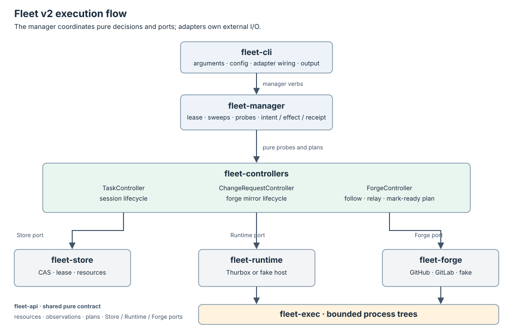

# Fleet architecture

Fleet v2 is a Rust command-line program that persists Tasks and drives one
Task controller. A Task contains the execution inputs for one agent session:
harness, host, workspace, brief and expected outputs. The worker reports its
own result.



Arrows show calls during execution, not Cargo dependencies. `fleet-cli`
constructs the adapters; `fleet-manager` depends on API traits rather than
concrete store or runtime crates.

## Components and boundaries

| Crate | Owns | Boundary |
| --- | --- | --- |
| [fleet-cli](crates/fleet-cli/src/main.rs) | Parse arguments, load config, construct adapters, print results | Calls manager verbs; does not write resources or run controller effects directly. |
| [fleet-manager](crates/fleet-manager/src/lib.rs) | Reconcile loop, lease renewal, plan execution, apply/delete/result verbs | Reads and writes through `Store`; observes and performs effects through `Runtime`. |
| [fleet-controllers](crates/fleet-controllers/src/task.rs) | Pure Task decisions | Receives time and observations as values; returns probes and a plan without I/O. |
| [fleet-api](crates/fleet-api/src/lib.rs) | Task, plan, observation, result and port types | Pure shared contract; no adapter dependencies. |
| [fleet-store](crates/fleet-store/src/lib.rs) | File persistence, CAS, write ownership and lease fencing | A corrupt or unreadable record is Unknown; only proven absence is not-found. |
| [fleet-runtime](crates/fleet-runtime/src/lib.rs) | Session operations through thurbox, or the file-backed fake host | Converts external answers to Known/Unknown; retains identity and delivery keys. |
| [fleet-exec](crates/fleet-exec/src/lib.rs) | Bounded process execution | The only production process spawner; timeout/unwind kills the process tree. |

`fleet-arch` and `fleet-dev` are repository tooling: architecture enforcement,
validation and release packaging. They are not controllers or services in the
installed `fleet` runtime.

The executable dependency graph is [crates/architecture.toml](crates/architecture.toml).
The [architecture suite](crates/fleet-arch/tests/architecture.rs) checks crate
edges, purity, restricted process APIs and permitted status writers, including
negative fixtures. The CLI may wire adapters, but only manager verbs may
perform resource mutations.

## Desired state, observations and effects

The [Task controller documentation](docs/task-controller/README.md) defines
the [resource](docs/task-controller/resource.md),
[state machine](docs/task-controller/state-machine.md) and
[interface](docs/task-controller/interface.md).

One reconcile of a due Task follows this protocol:

```text
read Task + resourceVersion
  -> ask pure controller for probes
  -> renew lease before each runtime probe
  -> pass observations + time to pure controller
  -> CAS-write planned status, including effect intent
  -> renew lease before effect -> perform effect -> persist receipt
  -> remove finalizer if requested
```

The controller owns Task status except `status.result`, written through the
worker verb. A status conflict before an effect drops the plan and retries
from fresh state. A receipt conflict rereads the object and retries the receipt
write, preserving concurrent worker changes. Expired or superseded leases
refuse controller writes. An effect already started cannot be fenced by the
file store; deterministic keys and runtime observation recover that gap.

## Resource representation

[fleet-api](crates/fleet-api/src/meta.rs) defines Fleet's resource envelope
and metadata as native Rust types. Manifests use `apiVersion`, `kind`,
`metadata`, `spec` and `status`; typed Task views validate spec and status.
Unknown fields are refused. The store assigns identity, generation, resource
version, timestamps and finalizers, and treats incomplete persisted metadata
as Unknown rather than repairing it with defaults.

The file-store format is version 1. Resource versions are store-wide numeric
write counters used for compare-and-swap; timestamps are Unix milliseconds.
The resource API version is separately `fleet/v1alpha1`. These contracts do
not imply compatibility with Kubernetes metadata or APIs.

The workspace has no kube dependencies. Fleet's current consumers use its
own Store and Runtime ports, so resource validation, persistence, lease
fencing and effect recovery remain explicit Fleet contracts. A familiar
manifest shape does not require a Kubernetes resource library. The bounded
manager's scheduling behavior is defined below, independently of the
resource representation.

## Persistence and execution

The store uses a fresh versioned data directory with a format marker, resource
files, a sequence counter, a lock and the manager lease. Writes use synced
temporary files and atomic publication under an OS file lock. Generation
tracks spec changes; resourceVersion tracks store writes. See the
[store contract](crates/CONTRACTS.md#store) for durability and deletion rules.

There is one lease for manager reconciliation. `fleet reconcile` renews it
before Tasks, probes and effects, and releases it on exit when still owned.
A bounded `reconcile` run ends when a pass makes no change or reaches its pass
limit. `fleet up` instead keeps that same manager lease across periodic sweeps,
renewing before each sweep, Task, probe and effect. Retry eligibility remains
persisted as `status.notBefore`; due Tasks progress without agent activity.
Shutdown releases the lease and retains sessions; crash recovery waits for
lease expiry and observes deterministic session/effect keys.

The CLI's `init` installs the embedded, pinned VEGA workspace and a local
config without Git or network. Bootstrap file ownership and conflict copies
are local file concerns, separate from resource writes. `up` asks the manager
to create `Task/vega` only when absent, then runs the ordinary Task controller
for every due Task. VEGA has no extra resource kind, controller or privileges.
The [README](README.md#configuration-and-customization) owns config precedence,
managed/editable files, source provenance and startup/recovery instructions.

The runtime is chosen in versioned TOML config, not a separate resource.
Thurbox owns host connections and session execution. Fleet calls it through
bounded processes; the fake runtime provides persisted fault injection for
isolated tests. Runtime operations report their worst-case duration so the
CLI can reject a lease too short to outlast them.

## Scope and compatibility

The Task controller runs sessions and records worker claims. It does not
verify that an artifact merged, conduct reviews, manage a forge, dispatch a
hierarchy or load controller plugins. Connection details stay with thurbox;
credentials stay with the agent and host.

V2 does not read or migrate v1 queue records or configuration. Root
`FLEET_MAJOR=2` is the boundary checked by v1 installations containing the
freeze guard; unpatched clients need the pinned release first. The
[README](README.md) owns stable v1 installation, explicit v2 opt-in and the
deliberate cutover procedure. Production release readiness remains held.
