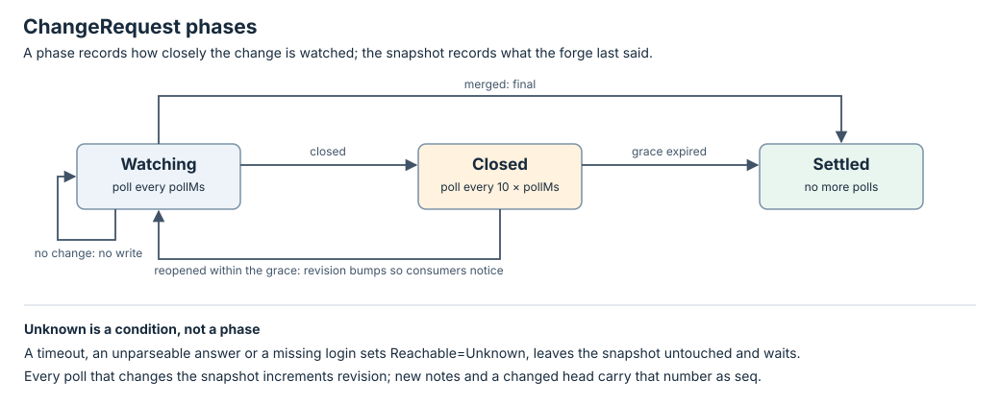

# ChangeRequest state machine

Design, not implemented.

`status.phase` records how closely the change is watched. The snapshot fields
record what the forge last said. The [interface](interface.md) defines the one
probe used here.

## Transition rules

The manager only reconciles a ChangeRequest whose `notBefore` is absent or
due. Deletion removes the record from any phase.

| Current phase | Observation | Next phase | Decision |
| --- | --- | --- | --- |
| Watching | Known, nothing differs from the snapshot | Watching | Write nothing; `notBefore = now + pollMs`. |
| Watching | Known, something differs; state draft or open | Watching | `revision += 1`; assign `seq` to new notes and a changed head; write the snapshot; wait `pollMs`. |
| Watching | Known, state merged | Settled | Write the final snapshot; `Settled=True/Merged`; no further polls. |
| Watching | Known, state closed | Closed | Write the snapshot; record when it closed; wait `10 × pollMs`. |
| Watching or Closed | Unknown | unchanged | `Reachable=Unknown` with the reason; snapshot untouched; wait the phase's interval. |
| Closed | Known, state draft or open | Watching | `revision += 1` even if nothing else differs, so consumers notice; wait `pollMs`. |
| Closed | Known, still closed, within `closedGraceMs` | Closed | Write only if something differs; wait `10 × pollMs`. |
| Closed | Known, still closed, past `closedGraceMs` | Settled | `Settled=True/ClosedGraceExpired`; no further polls. |
| Settled | none asked | Settled | Terminal. A change reopened after the grace is a new ChangeRequest. |

A Known answer whose `ref` no longer resolves, because the change was deleted
on the forge, is `Settled=True/Gone`. An answer the adapter cannot parse is
Unknown, not gone.

## Sequence numbers

`revision` only moves when the snapshot changes, so a quiet change costs no
writes. `seq` on a note is the `revision` that first showed it; `head.seq` is
the `revision` that last changed `(head.id, head.checks)`. The newest 100
notes are kept; `droppedBefore` rises to the `seq` of any note rotated out,
so a consumer whose cursor is below it knows it has a gap rather than silently
missing a note. The [ChangeRequest resource](../resources/change-request.md#sequence-numbers)
says why the counter is Fleet's and not the forge's clock.

## Conditions

| Type | True means / relevant reason |
| --- | --- |
| Reachable | The last poll read the change. Unknown with a reason after a timeout, an unparseable answer or a missing login. |
| Mergeable | Not draft, checks passed on the current head, no unresolved inline thread, `reviewDecision` not `changes-requested`. Read-only: Fleet reports it and never acts on it. |
| Settled | `Merged`, `ClosedGraceExpired` or `Gone`. |

Conditions keep their `lastTransitionTime` unless their status changes, so a
pass that sees nothing new writes nothing.

## Deletion

`fleet delete changerequest NAME` removes the record on the next pass. There
is no finalizer because nothing on the forge is held. A ChangeRequest owned by
a Task is deleted when the Task is.
