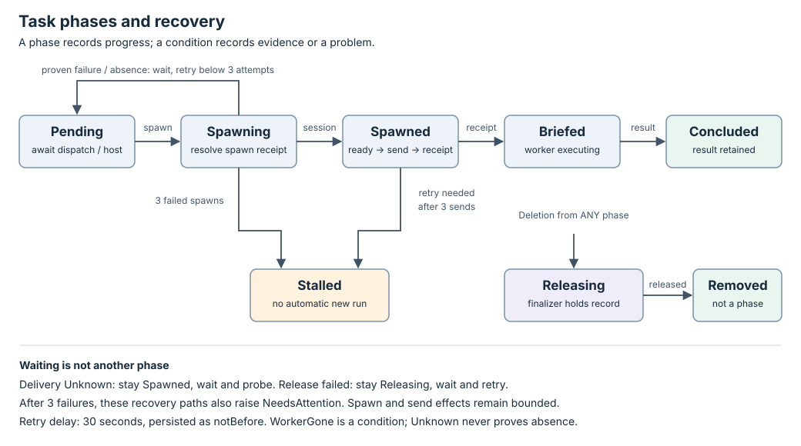

# Task state machine

`status.phase` records execution progress. Conditions describe facts and
problems within that phase; an effect intent or a worker's result is not
proof of an external artifact landing. The
[controller interface](interface.md) defines the probes and effects used here.

## Transition rules

The manager only reconciles Tasks whose `notBefore` is absent or due, and a
Concluded Task only while its inbox is nonempty or it is being deleted.
Deletion takes precedence over normal progress, including Stalled and
Concluded. With no deletion, those two phases are terminal; a Concluded Task
with a nonempty `status.inbox` is nevertheless due again, for delivery only.
A recorded worker result concludes an active Task before its ordinary phase
logic runs.

| Current phase | Observation or input | Next phase | Decision |
| --- | --- | --- | --- |
| Pending | `dispatch: false` | Pending | Set `Spawned=False/AwaitingDispatch`; do not spawn. |
| Pending | Dispatched; host false, Unknown or unanswered | Pending | Report host condition; do not spawn. |
| Pending | Dispatched; host reachable | Spawning | Increment spawn attempt; persist spawn intent and plan Spawn. |
| Spawning | Known Spawned receipt | Spawned | Record returned SessionRef. |
| Spawning | Missing/Unknown receipt; session key found | Spawned | Adopt the session and recover its receipt. |
| Spawning | Known failure, or ambiguous outcome with key proven absent; attempts below 3 | Pending | Schedule a wait before another spawn. |
| Spawning | Same failure with 3 spawn attempts spent | Stalled | Raise `Stalled/SpawnAttemptsExhausted` and NeedsAttention. |
| Spawning | Missing/Unknown receipt; session list unreadable | Spawning | Report Unknown; never infer absence or respawn blindly. |
| Spawned | Readable lookup lacks the recorded session identity | Spawned | Raise WorkerGone and NeedsAttention; do not send. |
| Spawned | Known Delivered receipt, or journal proves delivered | Briefed | Record brief key and generation; recovered journal answers become receipts. |
| Spawned | No brief intent yet, or delivery proven absent; fresh readiness true; fewer than 3 sends spent | Spawned | Persist brief intent and plan Brief. A later pass consumes its receipt. |
| Spawned | Session not ready or readiness Unknown | Spawned | Do not send, including on a retry. Receipt recovery may still proceed. |
| Spawned | Delivery unreadable after an ambiguous send | Spawned | Wait, then probe again; after 3 unreadable probes raise NeedsAttention. |
| Spawned | Another send would exceed the 3-send bound | Stalled | Raise `Stalled/BriefAttemptsExhausted` and NeedsAttention. |
| Briefed | No result; recorded session present or lookup unreadable | Briefed | Wait for result; Unknown does not mean WorkerGone. |
| Briefed | No result; readable lookup lacks recorded identity | Briefed | Raise WorkerGone and NeedsAttention; never abandon or respawn. |
| Active phase | Accepted worker result is stored | Concluded | Set `Concluded=True/ResultRecorded`; keep the session. |
| Spawned, Briefed or Concluded | Oldest inbox entry has no receipt; session ready; nothing else sent this pass | unchanged | Persist the entry's intent and plan `Brief` under its key; one entry per pass. In Spawned the brief goes first: nothing is delivered while a brief send is unconfirmed. |
| Spawned, Briefed or Concluded | Oldest inbox entry; session not ready or Unknown | unchanged | Do not send. Readiness Unknown raises `NeedsAttention/ReadyUnknown` with its reason unless another attention holds; a Known answer clears it. Receipt recovery through `BriefDelivered` may still proceed. |
| Spawned, Briefed or Concluded | Known Delivered receipt, or journal proves delivered | unchanged | Record the receipt in `status.deliveries` and remove the entry, in one write; its intent, receipt and attempt records go with it. |
| Spawned, Briefed or Concluded | Entry send refused (Known failure) | unchanged | Wait, then send again under the same key to a session observed ready; at most 3 sends. |
| Spawned, Briefed or Concluded | Entry delivery unreadable after an ambiguous send | unchanged | Wait, then read the journal again; after 3 unreadable reads raise `NeedsAttention/DeliveryUnconfirmed`, and keep reading. |
| Spawned, Briefed or Concluded | A fourth send of one entry would be needed | unchanged | `NeedsAttention/DeliveryFailed` naming the entry; the entry stays, marked failed, and later entries are still delivered. |
| Spawned, Briefed or Concluded | More than 20 entries undelivered | unchanged | `NeedsAttention/InboxFull`; cleared once delivery brings the count back within the bound. |
| Concluded | Readable lookup lacks the recorded session | Concluded | `WorkerGone` and `NeedsAttention`; never a respawn. |
| Stalled | Any inbox entry | Stalled | Nothing is delivered; Stalled has no session to deliver to. |
| Any phase | Task marked deleting | Releasing | Resolve spawn ambiguity if needed; release only once at rest or proven absent. A deleting Task delivers nothing. |
| Releasing | Busy session or unreadable rest/lookup evidence | Releasing | Keep finalizer; wait for safe evidence. |
| Releasing | Failed, missing or Unknown release receipt | Releasing | Wait and retry; after 3 attempts also raise NeedsAttention. |
| Releasing | Known Released receipt, or nothing was spawned and nothing remains to release | Record removed | Remove finalizer; removal is not another phase. |

A Spawned phase without a SessionRef is an invalid internal combination; the
controller returns it to Pending instead of sending to nobody. Normal store
and controller paths record identity before entering Spawned.

## Retries and recovery

`MAX_ATTEMPTS=3` bounds spawn effects and brief sends. `RETRY_DELAY_MS=30000`
is a fixed wait, persisted as `status.notBefore` across process restarts.
These are controller constants, not extra configuration resources.

| Situation | Evidence required before proceeding | Wait and exhaustion behavior |
| --- | --- | --- |
| Spawn failed or was proven absent | A failure receipt, or readable key lookup after an ambiguous spawn | Wait before the next attempt; after the third failed attempt enter Stalled. |
| Brief send refused | Known failure before confirmed delivery | Wait before retry; every retry needs fresh readiness; at most 3 sends. |
| Brief send answer missing/Unknown | Read the session's journal under the original brief key | Delivered recovers without sending; proven not delivered permits a ready-session send; Unknown waits and probes again. |
| Delivery journal unreadable | A later readable journal answer | After 3 failures raise NeedsAttention, but keep probing after each wait. Recovery clears BriefUnconfirmed attention. |
| Release answer missing/Unknown or failed | Recorded session at rest, or key proven absent; adapter preserves exact identity | Wait once per failed attempt, then retry. After 3 attempts raise NeedsAttention but continue; success releases the finalizer. |
| Session lookup unreadable | A later readable lookup | Unknown is not absence and does not by itself trigger WorkerGone or permit a blind spawn. |
| Inbox entry send refused or answer missing/Unknown | As for the brief, under the entry's key: a failure receipt, or the journal's answer | Wait before retry; every retry needs fresh readiness; at most 3 sends per entry, then `DeliveryFailed` and the next entry. Unknown journal reads continue after each wait; three raise `DeliveryUnconfirmed`. |

A single brief key is reused so retrying a proven-undelivered brief does not
create a new delivery identity, and each inbox entry's key is reused the same
way. The thurbox pending journal prevents another
send when the first might already have typed text. A key reused by a different
session is not proof that the original worker is alive and does not transfer
at-rest proof to that replacement.

`fleet reconcile` exits at a fixed point; it does not wait for `notBefore`.
Invoke it again after the deadline. Stalled Tasks do not retry automatically;
unreadable-delivery and release recovery continue on later due invocations.
A different brief or a fresh run requires a new Task. Changing `dispatch`
does not clear attempt counters or revive a Stalled Task.

## Conditions

Each condition carries `status` (True, False or Unknown), `reason`, `message`,
`observedGeneration` and `lastTransitionTime`. The transition timestamp is
retained when its status has not changed against stored state. Conditions
are last recorded observations; absence of a condition is not a True value.

| Type | True means / relevant reason |
| --- | --- |
| HostReachable | The host answered reachable during the dispatch check. |
| Spawned | The spawn returned a session or the controller adopted its key. |
| Briefed | The brief has a `ReceiptWritten` or `ReceiptRecovered` record. |
| Stalled | `SpawnAttemptsExhausted` or `BriefAttemptsExhausted`. |
| WorkerGone | A readable lookup no longer shows the recorded identity under its key (`SessionGone`). |
| Concluded | A worker result was accepted and observed (`ResultRecorded`). |
| Released | A known release completed, or there was nothing to release. |
| NeedsAttention | Reason is Stalled, WorkerGone, BriefUnconfirmed, ReleaseFailed, DeliveryFailed, DeliveryUnconfirmed, ReadyUnknown or InboxFull. |

WorkerGone clears when the exact recorded session is seen again. A successful
delivery recovery clears attention whose reason is BriefUnconfirmed or
DeliveryUnconfirmed; an inbox drained back within its bound clears InboxFull;
a Known readiness answer while an entry waits clears ReadyUnknown.
DeliveryFailed stays while the failed entry does. A
successful release removes the Task; a worker result alone is not a general
reset of previous conditions. NeedsAttention does not universally stop the
controller: its reason and phase determine what continues. Delivering an
inbox entry changes no phase and no condition other than those four.

## Deletion protocol

The [store](../../../crates/fleet-store/src/lib.rs) adds `fleet.dev/release` at
Task creation. `fleet delete` marks the Task, then reconciliation takes over.
No session ever spawned means nothing needs releasing. If a spawn was
interrupted before its receipt, the controller first looks up its key so it
cannot orphan an unknown session.

For a recorded session, the controller requires Known at-rest or readable
absence before planning Release. Thurbox checks that the current key holder
still has the recorded id before deleting it; a replacement yields Unknown.
The finalizer remains while release is failed or ambiguous. It is removed
only after Known Released, or when there is no session to release. The
session and its conversation/workspace may be deleted by the runtime, so a
worker result does not itself authorize release before Task deletion.

See [implementation and tests](README.md#implementation-and-evidence) for the
fault, lease-loss and identity regressions that exercise these paths.
