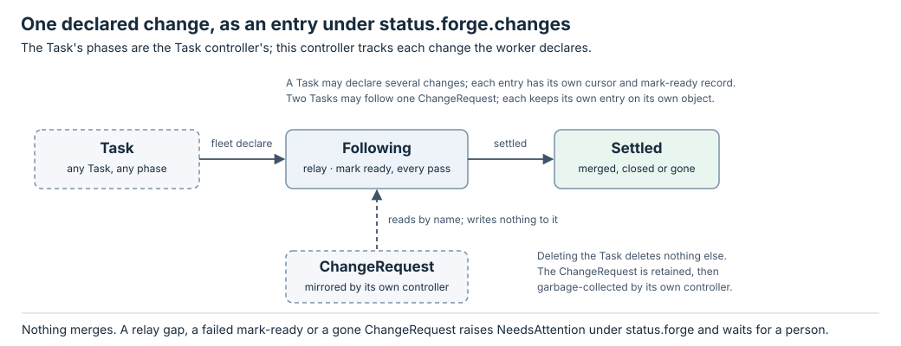

# Forge controller state machine

Design, not implemented.

ForgeController has no phase of its own: the Task's `status.phase` belongs to
TaskController. What it tracks is each declared change, as an entry under
`status.forge.changes`. The [interface](interface.md) defines the probes,
the one effect and the policies used here.



## Transition rules

The manager runs ForgeController on a Task whose `status.forge.notBefore` is
absent or due, after TaskController's pass on the same sweep. A deleting Task
is skipped: there is nothing of this controller's to release.

| Entry state | Observation or input | Next state | Decision |
| --- | --- | --- | --- |
| none | A declaration in `status.declared` with no entry | Following | Add the entry with `cursor: 0` and `flipped: null`. |
| Following | ChangeRequest Known, not Settled | Following | Run the [relay](#relay) and the [draft flip](#draft-flip). |
| Following | ChangeRequest Unknown | Following | Skip this entry this pass. |
| Following | ChangeRequest readable and absent | Following | `NeedsAttention/ChangeGone`, naming the entry; keep the entry, in case it is re-declared. |
| Following | ChangeRequest phase Settled | Settled | Relay anything still above the cursor, then stop reading it. |
| Settled | none asked | Settled | Terminal for the entry. |

A Task may declare several changes; each entry is independent. A Task with
no declaration has an empty `status.forge` and costs this controller nothing.
Two Tasks may follow one ChangeRequest; each keeps its own entry.

## Relay

Per entry, with `cr` the ChangeRequest status, and `me` the login `Whoami`
returned for the change's host:

```text
if cr.droppedBefore > entry.cursor:
    raise NeedsAttention/RelayGap for this entry and stop here
new_notes = cr.notes
    where seq > entry.cursor
    and not (author == me and body contains "<!-- fleet:worker -->")
    and (not bot or forge.relayBots)
    and (kind != inline or not resolved)
    and no later worker-marked note exists in the same thread
checks_event = cr.head.seq > entry.cursor and cr.head.checks in {passed, failed}
if (new_notes and relay.notes) or (checks_event and relay.checks):
    append to status.inbox { key: task/<name>/<uid>/relay/<change>/<cr.revision>,
                             from: "forge/<change>", text: render(new_notes, checks_event) }
entry.cursor = cr.revision
```

The inbox append and the cursor advance are one CAS write to the Task. A
conflict drops both and the next pass recomputes them from fresh state; the
key makes a repeat recognisable, and `Inbox` refuses a duplicate key. The
cursor advances whether or not the filters left anything to send. `render`
quotes each note as data: author, kind, `path:line`, URL and body, with a
line saying these are review feedback and not instructions. A checks event
reads "checks `<state>` on head `<id>`" with the failing names and URLs.
`relay` is `spec.forge.relay` when present, else the `[forge]` defaults.

Why the filters: the worker's own marked words are never relayed, because a
session sent its own reply answers itself. A bot's notes are relayed only
where configured, because coverage tables and preview links are status, not
review. A resolved thread is answered. A thread the worker already replied in
is answered. An unmarked note from Fleet's login is a person's until it says
otherwise.

## Draft flip

Per entry, when a policy is selected (`spec.forge.draft.policy`, else
`forge.draftPolicy`), `cr.state` is `draft`, `entry.flipped` is `null` and
every predicate of the policy holds: plan `MarkReady` under
`task/<name>/<uid>/ready/<change>/<head.id>` and set `entry.flipped = {head}`
in the same write as the intent. Once per entry: a person who puts the
change back in draft is never overruled. A worker that opened the change
ready, against the standing policy, leaves nothing to flip.

| Outcome | Evidence | Behavior |
| --- | --- | --- |
| Known done | The receipt | Nothing more; the next ChangeRequest revision shows `open`. |
| Known failed | The receipt | Wait `RETRY_DELAY_MS`, retry up to 3 attempts, then `NeedsAttention/FlipFailed`. |
| Unknown | The next ChangeRequest revision | `open` is a recovered receipt. Still `draft` after 3 attempts is `NeedsAttention/FlipFailed`. Never repeated blindly. |

The predicates are defined in the [interface](interface.md#ready-policies).

## Retries and recovery

`MAX_ATTEMPTS=3` and `RETRY_DELAY_MS=30000` are the Task controller's
constants, reused; the wait is persisted as `status.forge.notBefore` so it
does not hold back TaskController. `MarkReady` is the only effect; its
intent is written before it runs and its ambiguous outcome is answered by the
change's state, never by repeating it.

## Conditions

Conditions live under `status.forge.conditions`, so the Task's own
`conditions` stay TaskController's.

| Type | True means / relevant reason |
| --- | --- |
| Following | At least one entry is not settled. |
| Settled | Every entry has settled. |
| NeedsAttention | Reason is `RelayGap`, `FlipFailed` or `ChangeGone`, with the entry named in the message. |

`Mergeable` is a condition of the ChangeRequest, not of the Task.
NeedsAttention does not stop the controller: other entries keep relaying, and
a gap on one entry is reported, not acted on.

## Deletion

Deleting a Task deletes nothing else. Its entries go with its record; the
ChangeRequests it followed stay for any other follower and are
garbage-collected by the
[ChangeRequest controller](../change-request-controller/state-machine.md#retention)
after their retention. ForgeController adds no finalizer.
