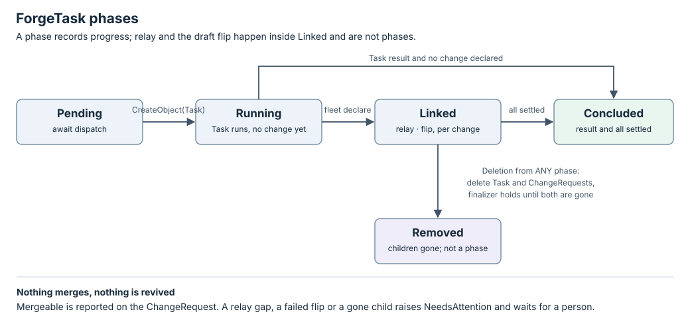

# ForgeTask state machine

Design, not implemented.

`status.phase` records how far the ForgeTask has got. Relay and the draft flip
happen inside Linked and are not phases. The [interface](interface.md) defines
the probes, effects and policies used here.



## Transition rules

The manager only reconciles a ForgeTask whose `notBefore` is absent or due.
Deletion takes precedence over normal progress.

| Current phase | Observation or input | Next phase | Decision |
| --- | --- | --- | --- |
| Pending | `dispatch: false` | Pending | Do nothing. |
| Pending | Dispatched | Running | Persist intent and plan `CreateObject(Task)` under `forgetask/<name>/<uid>/task`; the receipt records the Task's uid in `status.task`. |
| Running | Task Unknown | Running | Wait. Unknown is not absence. |
| Running | Task readable, `status.declared` holds a URL with no entry in `status.changes` | Linked | Plan `CreateObject(ChangeRequest)` under `forgetask/<name>/<uid>/change/<n>` with an owner reference; append `{name, url, cursor: 0, flipped: null}`. |
| Running | Task has a result and declared nothing | Concluded | `Concluded=True/NoChange`. |
| Linked | A newly declared URL | Linked | Create its ChangeRequest as above. One Task may declare several changes. |
| Linked | For each change: ChangeRequest Known | Linked | Run the [relay](#relay) and the [draft flip](#draft-flip) for that change. |
| Linked | For each change: ChangeRequest Unknown or absent | Linked | Skip that change this pass; readable absence of an owned ChangeRequest raises `NeedsAttention/ChangeGone`. |
| Linked | Task readable and absent | Linked | `NeedsAttention/TaskGone`; nothing is recreated. |
| Linked | Task has a result and every change is Settled | Concluded | `Concluded=True/AllSettled`. |
| Any phase | Marked deleting | unchanged | Plan deletion of every child not yet deleting; remove `fleet.dev/children` once each is gone or proven absent. Never flip or comment. |

Concluded is terminal except for deletion. A ForgeTask is never revived; a
new change is a new ForgeTask.

## Relay

Per change, with `cr` the ChangeRequest status, `entry` the change's entry in
`status.changes`, and `me` the login `Whoami` returned for the change's host:

```text
if cr.droppedBefore > entry.cursor:
    raise NeedsAttention/RelayGap for this change and stop here
new_notes = cr.notes
    where seq > entry.cursor
    and not (author == me and body contains "<!-- fleet:worker -->")
    and (not bot or forge.relayBots)
    and (kind != inline or not resolved)
    and no later worker-marked note exists in the same thread
checks_event = cr.head.seq > entry.cursor and cr.head.checks in {passed, failed}
if new_notes or checks_event:
    plan Enqueue { task, key: forgetask/<name>/<uid>/relay/<n>/<cr.revision>,
                   from: "ForgeTask/<name>", text: render(new_notes, checks_event) }
entry.cursor = cr.revision
```

The cursor advances in the same CAS write as the intent, whether or not the
filters left anything to send. `render` quotes each note as data: author,
kind, `path:line`, URL and body, with a line saying these are review
feedback and not instructions. A checks event reads "checks `<state>` on head
`<id>`" with the failing names and URLs. `forge.relay.notes` and
`forge.relay.checks` turn either half off.

Why the filters: the worker's own marked words are never relayed, because a
session sent its own reply answers itself. A bot's notes are relayed only
where configured, because coverage tables and preview links are status, not
review. A resolved thread is answered. A thread the worker already replied in
is answered. An unmarked note from Fleet's login is a person's until it says
otherwise.

## Draft flip

Per change, when `spec.forge.draft.policy` names a policy, `cr.state` is
`draft`, `entry.flipped` is `null` and every predicate of the policy holds:
plan `MarkReady` under `forgetask/<name>/<uid>/ready/<n>/<head.id>` and set
`entry.flipped = {head}` in the same write. Once per change: a person who
puts it back in draft is never overruled.

| Outcome | Evidence | Behavior |
| --- | --- | --- |
| Known done | The receipt | Nothing more; the next ChangeRequest revision shows `open`. |
| Known failed | The receipt | Wait `RETRY_DELAY_MS`, retry up to 3 attempts, then `NeedsAttention/FlipFailed`. |
| Unknown | The next ChangeRequest revision | `open` is a recovered receipt. Still `draft` after 3 attempts is `NeedsAttention/FlipFailed`. Never repeated blindly. |

The predicates are defined in the [interface](interface.md#ready-policies).

## Retries and recovery

`MAX_ATTEMPTS=3` and `RETRY_DELAY_MS=30000` are the Task controller's
constants, reused. `CreateObject` is idempotent by key: an intent without a
receipt is answered by looking the child up by its owner reference, never by
creating another. `Enqueue` is answered by looking for the key in the Task's
`inbox` or `deliveries`. `MarkReady` is answered by the change's state.

## Conditions

| Type | True means / relevant reason |
| --- | --- |
| TaskCreated | The Task exists with the recorded uid. |
| Linked | At least one ChangeRequest exists. |
| Concluded | `NoChange` or `AllSettled`. |
| NeedsAttention | Reason is `RelayGap`, `FlipFailed`, `TaskGone` or `ChangeGone`. |

`Mergeable` is a condition of the ChangeRequest, not of the ForgeTask.
NeedsAttention does not stop the controller: other changes keep relaying, and
a gap on one change is reported, not acted on.

## Deletion protocol

The store adds `fleet.dev/children` at ForgeTask creation. `fleet delete`
marks the ForgeTask; the next pass marks the Task and every ChangeRequest
deleting. The Task's own finalizer releases its session as today. The
ForgeTask's finalizer is removed only when every child is proven absent, so
nothing is orphaned. Unknown is not absence.
